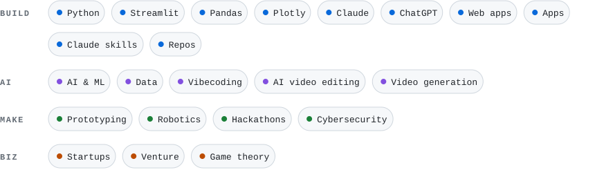

# Heeeeeey, I'm Georg 🇱🇹

I build whatever looks fun. Usually it starts as a joke and ends up as a repo.

Right now I'm:

- vibecoding apps, web apps and small tools
- prototyping fast and slowly sliding into robotics
- cutting and generating videos with AI
- writing Claude skills and poking ChatGPT until it does something weird
- showing up to hackathons and digging into cybersecurity
- figuring out how startups and venture money really work

  

## Stuff I play with

<picture>
  <source media="(prefers-color-scheme: dark)" srcset="assets/stuff-dark.svg">
  
</picture>

  

<a href="https://www.linkedin.com/in/georgkvantaliani">
  <picture>
    <source media="(prefers-color-scheme: dark)" srcset="assets/linkedin-dark.svg">
    
  </picture>
</a>
